# Apertus Grounded QA

LoRA post-training of [Apertus 8B Instruct](https://huggingface.co/swiss-ai/Apertus-8B-Instruct-2509) to answer
questions **only from the given context**, and to **say so when the context doesn't contain the answer**.
Training runs in two stages: supervised fine-tuning (SFT), then DPO on preference pairs ranked by a claim-level
verifier. The evaluation checks every claim in an answer against its context, and the automatic metrics are
validated against human labels before I trust them.

> **Status:** the pipeline is complete and tested end to end (unit tests plus a CPU smoke run on a tiny model).
> The GPU runs on Apertus are next, and results will go in [Results](#results). No numbers here are made up or
> projected.

## Why this project

Retrieval-augmented assistants fail in two typical ways. They add facts the retrieved context doesn't support,
and they answer anyway when retrieval missed. Both get worse on technical questions, where a plausible wrong
detail is costly. In earlier work on a 315-question technical testbed with expert references, I found that an
LLM-as-a-judge was not reliable enough on these questions. So this project measures faithfulness at the claim level
and checks the measurement against human labels.

## Results

_Not run yet._ After `scripts/run_all.sh`, `results/results.md` holds the table below. It reports 95% bootstrap CIs
and paired differences against the base model.

| Metric | Apertus-8B-Instruct | + SFT | + SFT + DPO |
|---|---|---|---|
| Grounded accuracy ↑ | | | |
| Abstains when unanswerable ↑ | | | |
| Refuses when answerable ↓ | | | |
| Claims supported by context ↑ | | | |
| Consistent with reference ↑ | | | |

Metric validity, from `groundqa.annotate agree` on a stratified, run-blind sample:

| Comparison | n | Agreement | Cohen's κ |
|---|---|---|---|
| claim supported: verifier vs human | | | |
| overall correct: verifier vs human | | | |
| overall correct: LLM judge vs human | | | |

## Method

```mermaid
flowchart LR
    D[rag-dataset-12000] -->|split by document| S[train / pref / val / test]
    S -->|30% context swaps| U[unanswerable cases]
    U --> SFT[LoRA SFT]
    SFT -->|4 samples per held-out prompt| V[claim verifier]
    V -->|best vs worst| P[preference pairs]
    P --> DPO[LoRA DPO on merged SFT]
    SFT & DPO --> E[eval: claims, abstention, reference]
    E --> H[human labels: is the metric right?]
```



**Data.** I use [`neural-bridge/rag-dataset-12000`](https://huggingface.co/datasets/neural-bridge/rag-dataset-12000)
(context, question and long-form answer; check its card for license and provenance). Two choices matter:

- *Split by document, not by question.* All questions about one context go to the same split, so test contexts are
  never seen in training.
- *Hard unanswerable cases.* In 30% of examples per split, the context is replaced with the most lexically similar
  context from another document (the best of 50 random candidates). A random swap would be trivially off-topic; a
  similar one makes the model actually check. The model is trained to reply with a fixed abstention string.

SQuAD 2.0 (with native unanswerable questions) and your own JSONL file are also supported. See
[Using your own testbed](#using-your-own-testbed).

**Stage 1: SFT.** LoRA (r=16, α=32, all linear layers) in bf16, loss on the answer tokens only, 2 epochs, cosine
schedule, best checkpoint by validation loss.

**Stage 2: DPO with a verifier as the reward.** The SFT model samples 4 answers per prompt on a held-out `pref`
split. That split is separate because SFT has already memorised the training answers. Each sample is scored as
follows:

| Case | Reward |
|---|---|
| Unanswerable, model abstains | 1.0 |
| Unanswerable, model answers | 0.0 |
| Answerable, model abstains | 0.3 |
| Answerable, model answers | share of claims supported × (0.5 + 0.5 × consistent with reference) |

The best and worst samples form a pair if their rewards differ by at least 0.5. If no sample is fully correct, the
reference answer becomes "chosen". The SFT adapter is merged into the weights, and DPO trains a new LoRA on top
(β=0.1), so the reference policy is the SFT model, not the original Instruct model.

**Evaluation.**

- *Claims:* each answer is split into sentence-level claims. An NLI cross-encoder
  ([DeBERTa-v3-large, MNLI/FEVER/ANLI/LingNLI/WANLI](https://huggingface.co/MoritzLaurer/DeBERTa-v3-large-mnli-fever-anli-ling-wanli))
  checks each claim against the context. The context is chunked, and the best-scoring chunk counts.
- *Abstention:* recall on unanswerable questions, over-refusal on answerable ones, and F1. The detector also accepts
  paraphrases, so the base model, which never saw the abstention string, isn't penalised for wording.
- *Reference:* each claim must also follow from the reference answer. Short references use span containment.
- *Headline:* grounded accuracy. An example counts as correct if the model abstains when it should, or, when it
  answers, every claim is supported and consistent with the reference.
- *Statistics:* 95% bootstrap CIs, plus paired bootstrap differences between models on the same examples.
- *Metric validation:* `groundqa.annotate` exports a stratified sample, shuffled so you can't tell which model wrote
  each row, and reports Cohen's κ between human labels and the verifier. Optionally it also compares an LLM judge
  (`groundqa.judge`, any OpenAI-compatible endpoint). The NLI threshold is tuned on these labels, not on the test
  metrics.

## Quickstart

```bash
pip install -e ".[dev]"          # add ".[qlora]" for 4-bit training
pytest                            # unit tests, CPU, seconds
python scripts/smoke_test.py      # full pipeline on a tiny random model, CPU, no downloads, ~2 min
```

### Colab or Kaggle

[`notebooks/run_pipeline.ipynb`](notebooks/run_pipeline.ipynb) runs every step on Google Colab or Kaggle. It
detects the platform and GPU and picks the model: Apertus 8B on a 40 GB+ GPU (Colab Pro A100), otherwise Apertus
1.5B (free T4 on Colab or Kaggle). Outputs go to Google Drive or `/kaggle/working`. Finished steps are skipped and
training resumes from its last checkpoint, so after a disconnect you just run it again. To redo later
stages with new settings, set `REDO_FROM = "dpo"` or `"eval"`; earlier outputs are moved aside, not deleted. Setup (GPU runtime, a
`GITHUB_TOKEN` secret for the private repo, an optional `HF_TOKEN`) is described at the top of the notebook.

To open it in Colab, use File → Open notebook → GitHub (with private repos enabled), or
[this link](https://colab.research.google.com/github/kiril-buga/apertus-grounded-qa/blob/main/notebooks/run_pipeline.ipynb).
On Kaggle, download the `.ipynb` from GitHub and use File → Import Notebook.

### Command line

Dev loop on Apertus 1.5B (one 16 GB+ GPU):

```bash
bash scripts/run_all.sh configs/apertus1p5b_dev.yaml runs/dev
```

Full run on Apertus 8B (one 40–80 GB GPU, such as an A100 or H100):

```bash
bash scripts/run_all.sh configs/apertus8b.yaml runs
python -m groundqa.annotate export --config configs/apertus8b.yaml \
    --verified base=runs/verified/base.jsonl --verified sft=runs/verified/sft.jsonl \
    --verified dpo=runs/verified/dpo.jsonl --n 100 --out results/annotation.csv
# label results/annotation.csv, then:
python -m groundqa.annotate agree --csv results/annotation.csv
```

Each step can also be run on its own (`python -m groundqa.<step> --help`). Any config value can be overridden with
`--set section.key=value`, for example `--set sft.lr=2e-4`.

**Compute.** Swiss AI's [fine-tuning recipes](https://github.com/swiss-ai/apertus-finetuning-recipes) report that
LoRA on the 8B model fits a single 40 GB GPU. With the default sizes (6,000 SFT examples, 2,000 preference prompts,
600 test questions), I expect the full pipeline to take well under a day on one A100 or H100. I'll replace this
estimate with measured times after the first run. `model.dtype: auto` uses bf16 on Ampere or newer GPUs and fp16 on
T4/P100. For 8B on a 16–24 GB GPU, `model.load_in_4bit=true` covers SFT and evaluation, but not DPO, which merges
adapters.

## Using your own testbed

Write one JSON object per line:

```json
{"id": "q-001", "question": "...", "context": "...", "answer": "... or null if unanswerable", "group": "doc-17"}
```

Then set `data.source: jsonl` and `data.path: path/to/file.jsonl`. `group` keeps related questions in one split
(it defaults to a hash of the context). Set `unanswerable_fraction: 0` if your file already has unanswerable cases.

## Design decisions

- **Why not judge with an LLM?** Judges are cheap, but on technical answers they can be confidently wrong. A claim
  verifier is narrower and auditable, and either one should be checked against human labels before you trust it.
  The repo measures both.
- **Why a separate `pref` split?** Sampling the SFT model on its own training prompts mostly reproduces memorised
  references, so the pairs carry little signal.
- **Why merge SFT before DPO?** With the PEFT adapter disabled, TRL uses the frozen model as the DPO reference.
  Merging first makes that reference the SFT policy, which is what the KL term should anchor to.
- **Why `all-linear` LoRA targets?** Apertus uses a non-gated xIELU MLP, so module names differ from Llama.
  `all-linear` avoids hard-coding them.

## Limitations

- The data is web text with synthetic answers, not expert-written technical QA. Running the same pipeline on an
  expert testbed is the obvious next step.
- Sentence-level claims are coarse. A sentence that mixes a supported and an unsupported fact can pass or fail as a
  unit. The human-agreement numbers show how much this matters.
- Context-swap negatives can occasionally contain the answer by coincidence. Human labels catch these, and the
  annotation CSV has a notes column for them.
- The NLI model has a 512-token window. Chunking deals with long contexts but can miss evidence split across chunks.

## Layout

```
configs/            apertus8b.yaml (main), apertus1p5b_dev.yaml (cheap iteration)
src/groundqa/
  data.py           loaders, document-level split, hard-negative unanswerables
  prepare.py        writes data/<name>/{train,pref,val,test}.jsonl
  train_sft.py      stage 1, LoRA SFT (TRL)
  generate.py       batched generation with merged adapters; k samples for preference data
  verify.py         claim splitting, NLI verification, reference checks
  prefs.py          verifier reward and preference pairs
  train_dpo.py      stage 2, LoRA DPO on top of merged SFT
  metrics.py        metrics, bootstrap CIs, paired differences, Cohen's kappa
  report.py         Markdown comparison table
  annotate.py       human-label export and agreement
  judge.py          optional LLM judge for comparison
notebooks/          run_pipeline.ipynb (Colab / Kaggle)
scripts/            run_all.sh, smoke_test.py
tests/              unit tests
```
