# Apertus Grounded QA

[](https://github.com/kiril-buga/apertus-grounded-qa/actions/workflows/tests.yml)

LoRA post-training of the [Apertus](https://huggingface.co/swiss-ai) models to answer questions **only from the
given context**, and to **say so when the context doesn't contain the answer**. Training runs in two stages:
supervised fine-tuning (SFT), then DPO on preference pairs ranked by a claim-level verifier. The evaluation checks
every claim in an answer against its context, and the automatic metric is checked against human labels.

> **Status:** results so far are on **Apertus 1.5B** (Kaggle, one T4): SFT works and reproduces; four DPO
> attempts did not beat it, for reasons the evaluation exposed. The pipeline and config for
> [Apertus 8B Instruct](https://huggingface.co/swiss-ai/Apertus-8B-Instruct-2509) are ready but have not been run.
> Every result below comes from a saved notebook run.

## Why this project

Retrieval-augmented assistants fail in two typical ways. They add facts the retrieved context doesn't support,
and they answer anyway when retrieval missed. Both get worse on technical questions, where a plausible wrong
detail is costly. In earlier work on a 315-question technical testbed with expert references, I found that an
LLM-as-a-judge was not reliable enough on these questions. So this project measures faithfulness at the claim level
and checks the measurement against human labels.

## Results

Apertus 1.5B Instruct, 200 held-out test questions (140 answerable, 60 unanswerable). Full tables with 95% bootstrap
CIs, settings and commit references for every run: [`docs/results/1.5b.md`](docs/results/1.5b.md).

**SFT does what it should, and reproduces.**

| | Base | + SFT |
|---|---|---|
| Grounded accuracy | 22.5 | **63.5** |
| Abstains when the context lacks the answer | 10.0 | **98.3** |
| Refuses answerable questions | 0.0 | 0.0 |
| Claims supported by the context | 67.4 | **88.9** |
| Claims per answer | 2.32 | 1.47 |

(Run 3, metric v2; the gains shown all have CIs excluding 0. SFT grounded accuracy over three independent trainings:
62.5, 62.0, 63.5.) The base model answers 54 of 60 unanswerable questions anyway, with invented details: an "Emily
Chen" as Utah State valedictorian, "Multi-Functional Energy Storage Hub" for MESH, Donovan Solano as "a player in the
NFL".

**DPO did not beat SFT. Each attempt failed in a way the evaluation explained.**

| DPO attempt | What changed | What happened |
|---|---|---|
| 1 | 213 pairs, 1 epoch, lr 1e-5 | ~13 steps; loss stayed at ln 2 (0.692). No learning, no change. |
| 2 | 565 pairs, 3 epochs, lr 2e-5 | Learned (reward accuracy 93%), but learned to **say less**: 1.04 claims per answer, token F1 72 → 45. The precision-only reward made the shortest true sentence the best answer. Headline rose 62 → 81.5, which was the metric being gamed. |
| 3 | reward with reference coverage | Learned to **say more**: 4.74 claims per answer, claims supported 89 → 79%, headline 63.5 → 35. 66% of pairs had the reference answer as "chosen", so DPO mostly imitated long off-policy references. |
| 4 | F1 of on-topic precision and coverage; on-policy pairs only; β 0.3 | No hack, no gain: every metric within two points of SFT (headline 62.5 vs 63.5, 1.65 claims per answer). Only 379 of 1,123 prompts gave a pair, and validation reward accuracy stayed near 0.5–0.6 while train accuracy rose. Too little signal to move the model. |

**The human check that caught it.** 40 answered SFT and DPO rows from attempt 2, shuffled, labelled "does the answer
actually answer the question?":

| | SFT | SFT + DPO |
|---|---|---|
| Human: answers the question | **100%** | **75%** |
| Verifier (metric v1): correct | 55% | 70% |

Agreement 50%, Cohen's κ = −0.23: the automatic metric ranked the models in the wrong order. It accepted evasive
restatements ("Why was David Krejci moved to the third line?" → "He was moved to the third line.") and rejected
correct bare answers ("Navpad Steel"). Labels are in [`labels/1.5b_quick.json`](labels/1.5b_quick.json) (drafted by
an LLM, reviewed and accepted by me; n=20 per model, so read the gap as large, not precise).

Re-scoring the same 40 answers with the fixed verifier (metric v2) gives 70% agreement, κ = 0.32. It accepts none of
the five answers the human check rejected; its 12 errors are all correct answers it rejects, mostly for low coverage
of a long reference ("On March 7."). On these rows the fixed metric errs on the strict side, so the headline numbers
from attempt 3 on are more likely too low than inflated. Five rejected answers are too few to show it can't be
gamed, though.

**What I take from it**

- A single scalar reward built from a verifier gets optimized along its cheapest axis. Precision-only rewarded
  brevity; adding recall with a heavy weight rewarded padding.
- A metric that shares the reward's blind spot will report the hack as progress. Token F1, which was not part of the
  reward, was the first signal, and 40 human labels were enough to show the metric was wrong.
- Falling back to the reference answer as "chosen" made the preference data mostly off-policy; once two thirds of the
  pairs came from it, DPO moved the model towards reference style rather than towards better grounding.
- Closing both shortcuts (attempt 4: harmonic mean of precision and coverage, on-policy pairs only) stopped the
  damage, but left DPO with too little signal: for two thirds of the prompts the four samples scored too close to
  form a pair. My guess is that the verifier's own noise (κ 0.32) is large next to the differences DPO would have to
  learn; I haven't tested that.
- What I'd change next: more preference prompts and more samples per prompt so more pairs clear the gap; a
  coverage check that credits short correct answers; then the same recipe on 8B.

## Method

```mermaid
flowchart LR
    D[rag-dataset-12000] -->|split by document| S[train / pref / val / test]
    S -->|30% context swaps| U[unanswerable cases]
    U --> SFT[LoRA SFT]
    SFT -->|4 samples per held-out prompt| V[claim verifier]
    V -->|best vs worst| P[preference pairs]
    P --> DPO[LoRA DPO on merged SFT]
    SFT & DPO --> E[eval: claims, abstention, reference]
    E --> H[human labels: is the metric right?]
```



**Data.** I use [`neural-bridge/rag-dataset-12000`](https://huggingface.co/datasets/neural-bridge/rag-dataset-12000)
(context, question and long-form answer; Apache-2.0). Two choices matter:

- *Split by document, not by question.* All questions about one context go to the same split, so test contexts are
  never seen in training.
- *Hard unanswerable cases.* In 30% of examples per split, the context is replaced with the most lexically similar
  context from another document (the best of 50 random candidates). A random swap would be trivially off-topic; a
  similar one makes the model actually check. The model is trained to reply with a fixed abstention string.

SQuAD 2.0 (with native unanswerable questions) and your own JSONL file are also supported. See
[Using your own testbed](#using-your-own-testbed).

**Stage 1: SFT.** LoRA (r=16, α=32, all linear layers) in bf16 (fp16 on a T4), loss on the answer tokens only, 2 epochs, cosine
schedule, best checkpoint by validation loss.

**Stage 2: DPO with a verifier as the reward.** The SFT model samples 4 answers per prompt on a held-out `pref`
split. That split is separate because SFT has already memorised the training answers. Each sample is scored as
follows:

| Case | Reward |
|---|---|
| Unanswerable, model abstains | 1.0 |
| Unanswerable, model answers | 0.0 |
| Answerable, model abstains | 0.3 |
| Answerable, model answers | harmonic mean of on-topic precision (share of claims supported by the context *and* in the reference) and coverage of the reference |

Earlier attempts used claim support × (0.5 + 0.5 × consistent with reference) (attempts 1–2) and claim support ×
(0.2 × consistent + 0.8 × coverage) (attempt 3); see [Results](#results) for why each was replaced. The best and worst
of the model's own samples form a pair if their rewards differ by at least 0.3 (`prefs.min_gap`); the reference answer
is no longer used as "chosen" (`prefs.gold_fallback: false`). The SFT adapter is merged into the weights, and DPO trains a new LoRA on top
(β=0.3, 2 epochs), so the reference policy is the SFT model, not the original Instruct model.

**Evaluation.**

- *Claims:* each answer is split into sentence-level claims. An NLI cross-encoder
  ([DeBERTa-v3-large, MNLI/FEVER/ANLI/LingNLI/WANLI](https://huggingface.co/MoritzLaurer/DeBERTa-v3-large-mnli-fever-anli-ling-wanli))
  checks each claim against the context. The context is chunked, and the best-scoring chunk counts.
- *Abstention:* recall on unanswerable questions, over-refusal on answerable ones, and F1. The detector also accepts
  paraphrases, so the base model, which never saw the abstention string, isn't penalised for wording.
- *Short answers:* a claim under six words ("Navpad Steel") is judged as "The answer to the question … is: Navpad
  Steel", since an NLI model can't judge a bare name.
- *Reference:* each claim must also follow from the reference answer (precision), and *coverage* measures the share
  of the reference's sentences that follow from the question plus answer (recall). Short references use span
  containment.
- *Headline:* grounded accuracy. An example counts as correct if the model abstains when it should, or, when it
  answers, every claim is supported, consistent with the reference, and covers at least half of it.
- *Statistics:* 95% bootstrap CIs, plus paired bootstrap differences between models on the same examples.
- *Quick human check:* the notebook prints 40 shuffled answers; you mark each y/n for "does it answer the
  question?" and get agreement with the verifier. Saved labels (`labels/`) are re-scored by `groundqa.annotate
  quick` whenever the metric changes.
- *Metric validation:* `groundqa.annotate` exports a stratified sample, shuffled so you can't tell which model wrote
  each row, and reports Cohen's κ between human labels and the verifier. Optionally it also compares an LLM judge
  (`groundqa.judge`, any OpenAI-compatible endpoint). If you tune the NLI threshold, tune it on these labels, not
  on the test metrics. In the runs above it stayed at the default 0.5.

## Quickstart

```bash
pip install -e ".[dev]"          # add ".[qlora]" for 4-bit training
pytest                            # unit tests, CPU, seconds
python scripts/smoke_test.py      # full pipeline on a tiny random model, CPU, no downloads, ~2 min
```

### Colab or Kaggle

[`notebooks/run_pipeline.ipynb`](notebooks/run_pipeline.ipynb) runs every step on Google Colab or Kaggle. It
detects the platform and GPU and picks the model: Apertus 8B on a 40 GB+ GPU (Colab Pro A100), otherwise Apertus
1.5B (free T4 on Colab or Kaggle). Outputs go to Google Drive or `/kaggle/working`. Finished steps are skipped and
training resumes from its last checkpoint, so after a disconnect you just run it again. To redo later
stages with new settings, set `REDO_FROM = "dpo"`, `"prefs"` or `"eval"`; earlier outputs are moved aside, not deleted. Setup (GPU runtime, a
`GITHUB_TOKEN` secret for the private repo, an optional `HF_TOKEN`) is described at the top of the notebook.

To open it in Colab, use File → Open notebook → GitHub (with private repos enabled), or
[this link](https://colab.research.google.com/github/kiril-buga/apertus-grounded-qa/blob/main/notebooks/run_pipeline.ipynb).
On Kaggle, download the `.ipynb` from GitHub and use File → Import Notebook.

### Command line

Dev loop on Apertus 1.5B (one 16 GB+ GPU):

```bash
bash scripts/run_all.sh configs/apertus1p5b_dev.yaml runs/dev
```

Full run on Apertus 8B (one 40–80 GB GPU, such as an A100 or H100):

```bash
bash scripts/run_all.sh configs/apertus8b.yaml runs
python -m groundqa.annotate export --config configs/apertus8b.yaml \
    --verified base=runs/verified/base.jsonl --verified sft=runs/verified/sft.jsonl \
    --verified dpo=runs/verified/dpo.jsonl --n 100 --out results/annotation.csv
# label results/annotation.csv, then:
python -m groundqa.annotate agree --csv results/annotation.csv
```

Apertus 8B SFT and evaluation on one 16 GB GPU (QLoRA, e.g. an RTX 4080 Super). Same data, test questions and
SFT recipe as the 1.5B dev run, so the results line up with it. On Windows, run it in WSL2 (Ubuntu). It needs
Python 3.11 or newer (Ubuntu 22.04 ships 3.10); [uv](https://docs.astral.sh/uv/) fetches one without touching the
system Python:

```bash
curl -LsSf https://astral.sh/uv/install.sh | sh && source $HOME/.local/bin/env
uv venv --python 3.12 .venv && source .venv/bin/activate
uv pip install torch                               # the default Linux wheel is a CUDA build
uv pip install "transformers==5.19.*" "trl==1.15.*" "peft==0.21.*" -e ".[qlora]"
hf auth login                                      # only if the model page asks you to accept its terms
python scripts/run_sft_eval.py --check             # 3 SFT steps and 4 answers: catches setup problems early
python scripts/run_sft_eval.py                     # the full run; rerun the same command after an interruption
```

The first run downloads about 16 GB of weights. The results (table, training log, verified answers, GPU and
step timings) land in `results/8b/`, ready to commit.

Each step can also be run on its own (`python -m groundqa.<step> --help`). Any config value can be overridden with
`--set section.key=value`, for example `--set sft.lr=2e-4`.

**Compute.** Swiss AI's [fine-tuning recipes](https://github.com/swiss-ai/apertus-finetuning-recipes) report that
LoRA on the 8B model fits a single 40 GB GPU. With the default sizes (6,000 SFT examples, 2,000 preference prompts,
600 test questions), I estimate the full pipeline at well under a day on one A100 or H100 (not measured). Measured on a Kaggle
T4 with the 1.5B dev config: SFT training about 46 min and DPO training 25–55 min (generation and verification come on top). `model.dtype: auto` uses bf16 on Ampere or newer GPUs and fp16 on
T4/P100. For 8B on a 16–24 GB GPU, `configs/apertus8b_16gb.yaml` loads the model in 4 bits; that covers SFT and
evaluation, but not DPO yet, which merges adapters into the weights.

## Using your own testbed

Write one JSON object per line:

```json
{"id": "q-001", "question": "...", "context": "...", "answer": "... or null if unanswerable", "group": "doc-17"}
```

Then set `data.source: jsonl` and `data.path: path/to/file.jsonl`. `group` keeps related questions in one split
(it defaults to a hash of the context). Set `unanswerable_fraction: 0` if your file already has unanswerable cases.

## Design decisions

- **Why not judge with an LLM?** Judges are cheap, but on technical answers they can be confidently wrong. A claim
  verifier is narrower and auditable, and either one should be checked against human labels before you trust it.
  The repo supports both; so far only the verifier has been checked against labels.
- **Why a separate `pref` split?** Sampling the SFT model on its own training prompts mostly reproduces memorised
  references, so the pairs carry little signal.
- **Why merge SFT before DPO?** With the PEFT adapter disabled, TRL uses the frozen model as the DPO reference.
  Merging first makes that reference the SFT policy, which is what the KL term should anchor to.
- **Why `all-linear` LoRA targets?** Apertus uses a non-gated xIELU MLP, so module names differ from Llama.
  `all-linear` avoids hard-coding them.

## Limitations

- The data is web text with synthetic answers, not expert-written technical QA. Running the same pipeline on an
  expert testbed is the obvious next step.
- Sentence-level claims are coarse. A sentence that mixes a supported and an unsupported fact can pass or fail as a
  unit. More human labels would show how much this matters.
- Context-swap negatives can occasionally contain the answer by coincidence. Human labels catch these, and the
  annotation CSV has a notes column for them.
- The NLI model has a 512-token window. Chunking deals with long contexts but can miss evidence split across chunks.
- Some questions refer to the page itself ("What is the context primarily discussing?"). Swapping in another page
  makes them answerable rather than unanswerable, so a few "unanswerable" labels are wrong.
- fp16 greedy decoding on a T4 isn't bit-for-bit reproducible; regenerating answers with the same adapter changed a
  few of them (see the run 2 / human-check tables).
- The human check is 40 rows labelled by one person, from an LLM-drafted proposal.

## Layout

```
configs/            apertus8b.yaml (main), apertus8b_16gb.yaml (QLoRA, 16 GB GPU), apertus1p5b_dev.yaml (cheap iteration)
src/groundqa/
  data.py           loaders, document-level split, hard-negative unanswerables
  prepare.py        writes data/<name>/{train,pref,val,test}.jsonl
  train_sft.py      stage 1, LoRA SFT (TRL)
  generate.py       batched generation with merged adapters; k samples for preference data
  verify.py         claim splitting, NLI verification, reference checks
  prefs.py          verifier reward and preference pairs
  train_dpo.py      stage 2, LoRA DPO on top of merged SFT
  metrics.py        metrics, bootstrap CIs, paired differences, Cohen's kappa
  report.py         Markdown comparison table
  annotate.py       human-label export and agreement
  judge.py          optional LLM judge for comparison
notebooks/          run_pipeline.ipynb (Colab / Kaggle)
docs/results/       full result tables per model, with run settings and commits
labels/             saved human labels, re-scored when the metric changes
scripts/            run_all.sh, run_sft_eval.py (SFT + eval, resumable), smoke_test.py
tests/              unit tests
```

## License and citation

Code under the [Apache License 2.0](LICENSE). If you redistribute this code or a modified version, keep the
[`NOTICE`](NOTICE) file, which credits the original work. If you use it in research or a project write-up, please
cite it; [`CITATION.cff`](CITATION.cff) has the details (GitHub shows them under "Cite this repository").

The base models ([Apertus](https://huggingface.co/swiss-ai)) and the dataset
([rag-dataset-12000](https://huggingface.co/datasets/neural-bridge/rag-dataset-12000)) have their own licenses.
